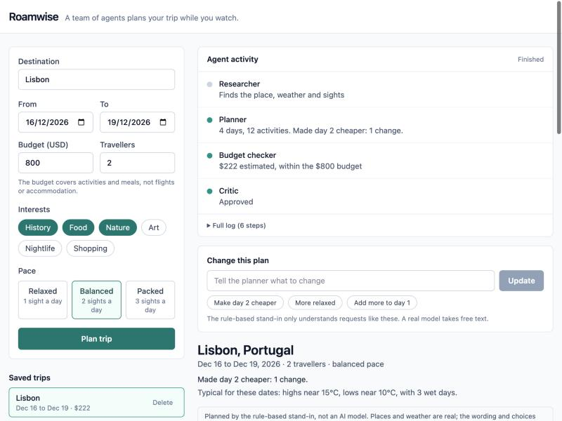
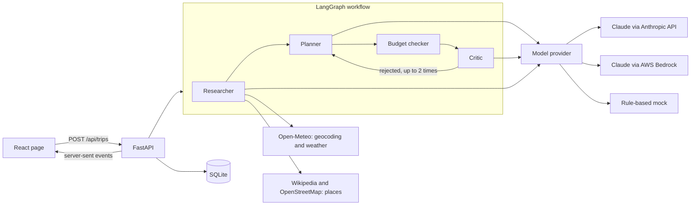

# Roamwise

[](https://github.com/shashankbg1/roamwise/actions/workflows/ci.yml)

An agentic trip planner. You give it a destination, dates, a budget and your interests. A team
of four agents researches the place, drafts a day-by-day plan, checks it against the budget and
critiques its own work, sending the plan back for revision when it falls short. Every step
streams to the browser as it happens.



## How it works



| Agent | What it does | How |
|---|---|---|
| Researcher | Resolves the destination, fetches weather for the dates and finds places matching the interests | Calls three public data sources, then asks the model to summarise |
| Planner | Arranges places into days: nearby sights together, indoor sights on wet days, pace respected | Model call with a typed output |
| Budget checker | Adds up costs per day and per category and compares them with the budget | Plain code, so the arithmetic is exact |
| Critic | Reviews the draft and either approves it or sends it back with specific issues | Model call with a typed output |

A follow-up such as "make day 2 cheaper" re-enters the workflow at the planner and reuses the
saved research.

## Run it locally

You need [uv](https://docs.astral.sh/uv/) and Node 22 or newer.

```bash
make install   # install backend and frontend dependencies
make dev       # backend on :8000, frontend on :5173
```

Open http://localhost:5173. No API key is needed: by default the agents run on a rule-based
stand-in, while the weather and places are real.

If `make dev` hangs before the frontend starts, your shell is blocking file watching. Run the
frontend with `ROAMWISE_NO_WATCH=1 npm run dev` (hot reload is off in that mode).

### Using a real model

Copy `backend/.env.example` to `backend/.env` and set the provider:

| `ROAMWISE_LLM_PROVIDER` | Backend | Needs |
|---|---|---|
| `mock` (default) | Deterministic rules | Nothing |
| `anthropic` | Claude through the Anthropic API | `ANTHROPIC_API_KEY` |
| `bedrock` | Claude through AWS Bedrock | AWS credentials and `ROAMWISE_AWS_REGION` |

`ROAMWISE_LLM_MODEL` selects the model (default `claude-opus-5-5`).

## Tests

```bash
make test   # 42 backend tests, all offline
make lint   # ruff for Python, oxlint for TypeScript
```

The tests never touch the network or a model: HTTP calls are served by `httpx.MockTransport`
and the agents run on the mock provider. They cover the data tools, the planning rules, the
full agent graph (happy path, revision loop, revision cap, unknown destination, refinement)
and the HTTP API including the event stream.

## Project layout

```
backend/
  app/
    agents/     the four agents, their prompts and the LangGraph workflow
    tools/      geocoding, weather and places lookups
    llm/        model provider interface, Claude provider, rule-based mock
    api/        HTTP routes and server-sent event streaming
    db/         saved trips (SQLite)
    models/     Pydantic schemas shared by everything above
  tests/
frontend/
  src/
    api/        typed client, including the event-stream reader
    components/ trip form, agent feed, itinerary view, refine box, saved trips
```

## Design decisions

- **A provider interface instead of calling the SDK from agents.** Agents ask for a typed
  result for a named task. That keeps them testable, and switching between the Anthropic API,
  Bedrock and the mock is one setting.
- **Structured outputs everywhere.** Every model answer is validated against a Pydantic schema,
  so the rest of the code never parses free text.
- **Facts come from tools, not the model.** Coordinates, weather and place names are looked up.
  Weather is attached to each day in code after planning, so a model cannot invent it.
- **Arithmetic in code.** The budget checker is deterministic. Models are unreliable at sums.
- **A capped critique loop.** The critic can reject a draft at most twice, which bounds cost and
  latency. If the plan still has problems, they are shown to the user instead of hidden.
- **Two place sources.** Overpass (OpenStreetMap) is volunteer-run and often slow, so it runs in
  parallel with Wikipedia under a short deadline and the results are merged. An outage degrades
  the result instead of failing the request.
- **Server-sent events over POST.** The browser's `EventSource` only supports GET, so the client
  reads the stream with `fetch` and parses events itself. Disconnecting cancels the agent run.

## Limitations

- The mock provider is a set of rules, not a model. It understands only a few refinement
  phrases ("cheaper", "more relaxed", "add more", optionally with "day N").
- The Claude provider has been written against the SDK but not yet exercised against the live
  API, and the Dockerfile has not yet been built.
- Costs are rough per-category estimates, not real prices, and exclude flights and
  accommodation.
- Places come from English Wikipedia and OpenStreetMap, so coverage varies by city, and
  restaurants only appear when Overpass responds.
- There is no authentication; saved trips are shared by everyone using the same server.

## Roadmap

Tracked on the [project board](https://github.com/users/shashankbg1/projects/1): flight and
hotel estimates, running on AWS Bedrock, deployment to AWS with Terraform, and a public demo
with an access code and a spending cap.
